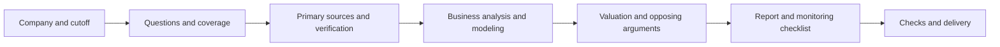

# Company Lens

[简体中文](README.md) | [English](README.en.md)

**Company Lens** is a company research skill for Codex and Claude Code. It uses public primary sources to study listed and private companies worldwide, covering business models, competition, financial quality, risks, and valuation. Deliverables include a **22-section research report, an Excel model with live formulas, and a monitoring checklist**.

It assesses **business quality, the credibility of growth, and valuation** separately, and identifies evidence that would overturn the research thesis.

[Quick start](#quick-start) · [Examples](#examples) · [Data sources](#data-sources) · [Deliverables](#deliverables) · [Model capabilities](#model-capabilities) · [Validation and limitations](#validation-and-limitations) · [Download the preview](https://github.com/gezi71/company-lens/releases/tag/v0.1.0)

> `v0.1.0` is a preview release. The agent running the skill needs web search, original-document reading, file access, and Python execution. Reports default to Chinese; this English README documents the same workflow. Most detailed references and templates are currently written in Chinese.

## Use cases

- **Researching a company for the first time:** understand its products, customers, economics, and competitive advantages.
- **Fundamental research and valuation:** examine earnings, cash, reinvestment, dilution, and the expectations implied by an observed price.
- **Updating research after earnings:** revisit affected evidence, assumptions, valuations, and thesis-breaking conditions while preserving the previous version.
- **Researching private companies:** establish what public evidence supports and document the information still needed.
- **Research-based writing:** complete the research first, then produce a Substack-style article when explicitly requested.

Worldwide coverage means finding relevant disclosures and local-language sources for each company. Data availability and disclosure quality determine the depth of research and which valuations can be supported.

## Quick start

### 1. Install for your agent

Choose the appropriate macOS / Linux personal installation below. If the target directory already exists, inspect the existing installation first.

The repository is named `company-lens`. The installation directory and invocation name remain **`comprehensive-company-research`** for compatibility with existing installations.

**Codex**

```bash
mkdir -p ~/.agents/skills
git clone https://github.com/gezi71/company-lens.git \
  ~/.agents/skills/comprehensive-company-research
```

**Claude Code**

```bash
mkdir -p ~/.claude/skills
git clone https://github.com/gezi71/company-lens.git \
  ~/.claude/skills/comprehensive-company-research
```

Alternatively, download the [release ZIP](https://github.com/gezi71/company-lens/releases/tag/v0.1.0), extract it, and place the entire `comprehensive-company-research` folder in the appropriate skills directory. Preserve the internal structure.

See [INSTALL.md](INSTALL.md) for project-scoped installation and Windows notes. Locations follow the [official OpenAI skill documentation](https://learn.chatgpt.com/docs/build-skills#where-codex-loads-local-skills) and [Claude Code skill documentation](https://code.claude.com/docs/en/skills). Organization policies and cloud environments may use different loading mechanisms.

### 2. Prepare Python

Inside the installed skill directory, create a virtual environment with **Python 3.10 or later**:

```bash
python3 -m venv .venv
.venv/bin/python -m pip install -r requirements.txt
```

Workbook generation requires `openpyxl`. Tell the agent to use the interpreter with the dependency installed, or an available platform-provided environment. See the [installation guide](INSTALL.md) for Windows.

Checking cached workbook calculations requires LibreOffice (`soffice` or `libreoffice`) or equivalent verification in the target environment. Python can independently evaluate the supported arithmetic without that engine; the deliverable must disclose when workbook caches have not been verified.

### 3. Start researching

In Codex:

```text
Use $comprehensive-company-research to research Microsoft comprehensively.
Complete the research report, Excel model, and monitoring checklist.
```

In Claude Code:

```text
/comprehensive-company-research Research Microsoft comprehensively.
Complete the research report, Excel model, and monitoring checklist.
```

The default information cutoff is the current date. The agent resolves ambiguous company identities before proceeding, then continues through the workflow. If the skill is not discovered, check the installation path, folder structure, and available skills; restart the session if needed.

## Examples

Append requirements like these to the skill invocation:

| Scenario | Example request |
|---|---|
| Listed company | Research Tencent comprehensively. Focus on the quality of gaming, advertising, and fintech revenue, capital allocation, and implied expectations, while covering the other applicable dimensions. |
| Supplied documents | Use the annual reports and spreadsheets I provide, verify material figures, and state the information cutoff. |
| Private company | Research a private industrial-sensor company. If financial disclosures are unavailable, complete the supported business, competitive, and risk analysis and list the information still needed. |
| Historical cutoff | Use only information publicly available by 2025-12-31. Exclude later filings and events. |
| Earnings update | Use the existing research directory and the latest earnings release to update facts, assumptions, valuation, and thesis killers. Preserve the previous version. |
| Article mode | After the research is complete, write a Substack-style article around one central question, retaining key sources and the strongest opposing arguments. |

## Research coverage

| Area | Questions and evidence |
|---|---|
| Company and business model | Actual operations, revenue mix, volume and pricing, geography, distribution, organic growth, acquisitions, and currency effects |
| Products, technology, and R&D | Product competitiveness, pricing, customer reviews, technology roadmaps, research spending, and results |
| Industry and competition | TAM / SAM / SOM, value chains, industry structure, cycles, peers, substitutes, and evidence of a moat |
| Customers and supply chain | Concentration, retention, switching costs, unit economics, critical suppliers, and bottlenecks |
| Financials and capital | Historical statements, earnings and cash, working capital, capex, debt, accounting adjustments, buybacks, and dilution |
| Management and organization | Execution against commitments, governance, incentives, employees, hiring, ownership, and capital allocation |
| Risks and opposing arguments | Bear cases, litigation, regulation, macro exposure, geopolitics, and observable falsification conditions |
| Valuation and expectations | Current and historical multiples, peers, appropriate intrinsic valuation, implied expectations, scenarios, and catalysts |

The original framework's **51 items** map into the report. The checklist also records process requirements, writing standards, and optional article mode. Each item needs a finding, report location, evidence, or an explanation of its limitations. See the [research checklist](references/research-map.md).

## Data sources

The agent retrieves data during research and can also use documents supplied by the user. Publicly accessible information is the default; entitled professional data sources can supplement it.

| Data | Main sources and handling |
|---|---|
| Financials and operations | Annual and interim reports, prospectuses, earnings releases, and financial notes; material figures are checked against the original disclosure |
| Management and strategy | Company websites, investor relations, earnings calls, investor days, and material announcements |
| Statutory and regulatory filings | SEC, mainland Chinese exchanges and CNINFO, HKEX, and the relevant local regulators and registries |
| Industry and competition | Government statistics, industry associations, peers, and disclosures by customers and suppliers |
| Market data and valuation | Accessible prices, market capitalization, share counts, peer data, and historical multiples, with timestamps and definitions |
| Supporting evidence | Reliable media, independent research, short reports, product reviews, hiring, patents, and community discussion |
| User-provided materials | Reports, spreadsheets, industry studies, and company documents, with provenance and verification status |

Material figures retain their period, currency, unit, and original-document locator. Facts, management claims, market estimates, assumptions, and inferences are distinguished. Reposts of the same original source do not count as independent verification.

Unavailable or undisclosed data remains unknown. Missing financials restrict private-company valuation; community discussion and alternative data help identify questions and corroborate evidence. The skill does not require a financial-database API key. The agent's account, network permissions, and execution environment are provided by its platform.

## Deliverables

| File | Purpose |
|---|---|
| **`report.md`** | A 22-section research report, in Chinese by default, with the 51-item coverage checklist, sources, conflicts, data gaps, and model-check notes |
| **`model.xlsx`** | Historical financials, operating assumptions, forecasts, appropriate valuation, scenarios, and sensitivity analysis, with live formulas and sourced inputs |
| **`tracker.md`** | Baselines, verification conditions, sources, review frequency, affected assumptions, and conclusions to revisit |

Default output structure:

```text
research/<company-id>/<information-cutoff>/
├── report.md
├── model.xlsx
├── model-results.json       # Arithmetic and engine checks
├── tracker.md
├── state.json               # Progress, gaps, and next steps
└── work/
    ├── input.json           # Reproducible model inputs
    ├── sources.json         # Source ledger
    ├── evidence.json        # Evidence, assumptions, and inferences
    ├── coverage.json        # The 51-item coverage record
    ├── claims.json          # Material numbers linked to evidence or models
    └── raw/                 # Original materials retained as permitted
```

An `article.md` is added only when article mode is explicitly requested. Workpapers support traceability and later updates. Limited research explains what is missing and how that affects the conclusions.

<details>
<summary>View the full 22-section report outline</summary>

1. Executive Summary
2. The One-Sentence Thesis
3. Why Now?
4. What Does the Company Actually Do?
5. How It Makes Money
6. Revenue Breakdown
7. Financial History
8. Unit Economics
9. Industry
10. Competitive Landscape
11. Moat
12. Management
13. Capital Allocation
14. Growth Drivers
15. What the Market Is Missing
16. Bear Case
17. Risks
18. Valuation
19. Bull / Base / Bear
20. Catalysts
21. Thesis Killers
22. Final Verdict

The headings and order are fixed. Inapplicable sections remain present with an explanation. See the [report template](assets/report-template.md) and [report contract](references/report-contract.md).

</details>

## Model capabilities

| Company type | Approach and constraints |
|---|---|
| Operating companies | Where disclosures support it, aim for five historical and five forecast years, linked statements, FCFF discounted at WACC, and implied-expectations analysis when a reliable price is available |
| Banks and insurers | Residual-income or dividend models using the cost of equity, supplemented by capital, asset-quality, reserve, or solvency analysis |
| Asset-based companies and holding companies | NAV or disclosure-supported sum-of-the-parts analysis, checking asset ownership and avoiding double-counted liabilities |
| Cyclical companies | Full-cycle evidence and mid-cycle assumptions, testing the sustainability of peak earnings and reinvestment |
| Loss-making growth companies | Unit economics, cash runway, a path toward profitability, financing, and dilution scenarios |
| Private companies | The relevant industry approach, with explicit restrictions when financials, transaction prices, or ownership terms are unknown |

The scripts provide basic building blocks for operating-company statements and FCFF, residual income, dividends, and NAV. Bear, base, and bull cases are evaluated separately; missing case inputs remain unknown. Sector-specific capital, reserves, complex taxes, leases, acquisitions, and financing schedules still need to be added from actual disclosures.

Important conventions include matching cash flows to discount rates, the enterprise-to-equity bridge, units, stock-based compensation and dilution, and fixed parameters in reverse valuation. See [modeling.md](references/modeling.md) for methods and [data-contract.md](references/data-contract.md) for input fields and script interfaces.

## Workflow and quality checks



- **Source checks:** align entity, period, currency, accounting framework, and consolidation scope; retain original locators and explain conflicts.
- **Calculation checks:** reconcile statements, cash and equity roll-forwards, valuation bridges, cases, and sensitivities. Record Python and spreadsheet-engine verification separately.
- **Consistency checks:** link material figures to evidence or model results and validate ledgers, coverage, and report structure. The author still checks the narrative and original documents.
- **Opposing arguments:** address the strongest bear case and define observable conditions that would invalidate the thesis. A supported disagreement with market expectations is not mandatory.
- **Scoring:** retain seven scores out of ten with evidence and clear direction. Insufficient evidence can mean no score; a higher risk score means higher risk.

Stage records support resuming interrupted research. A conditional deliverable is allowed when evidence is incomplete, with affected work marked `limited` rather than fully verified.

## Validation and limitations

Recorded validation includes:

- **21 automated tests** covering financial arithmetic, cases, missing and invalid inputs, basic sector models, file references, and the report mapping.
- **Independent behavioral review of four cases:** a manufacturer, a bank with incomplete information, a loss-making software business, and a private company without financial disclosures.
- **LibreOffice verification:** 2,461 non-missing formulas in the synthetic manufacturing model matched Python calculations.
- **Real-source spot checks:** two years of public financial figures, historical cash-flow observations, and balance-sheet reconciliation from Microsoft's FY2025 filing.

See [VALIDATION.md](VALIDATION.md) for the record and reproduction commands. Platform file conventions and relative paths have been checked, but the skill has not yet been invoked in two independent product sessions. Financial spot checks also do not constitute a complete, end-to-end 22-section report on a real company.

Research depends on available disclosures, the agent's reading and judgment, and model assumptions. Structural checks and recalculation do not establish the truth of every fact or narrative claim. Review material original documents, definitions, and the economic plausibility of the model before relying on a conclusion.

## Frequently asked questions

**Can I start with just a company name?**

Yes. The agent confirms the entity and builds a research plan. Ambiguous identities require clarification. You can also supply a ticker, exchange, information cutoff, and documents.

**Do I need a paid financial database?**

Public disclosures are the default. Unavailable consensus forecasts, customer data, or industry statistics are documented as gaps rather than replaced with invented facts.

**Will every company have five years of history and a valuation?**

Research uses the company's actual operating and disclosure history. Missing starting financials can prevent a complete model; without a reliable price, implied-market-expectations analysis may not apply.

**Does the monitoring checklist update automatically?**

The checklist specifies what to verify and how often. Updates require another research request; the repository does not include a scheduler.

**How do I update an installed copy?**

Run `git pull --ff-only` inside a Git-installed skill directory. Inspect local modifications before deciding how to merge them. For ZIP installations, download a newer version and preserve your changes.

Existing clones can update their remote after the repository rename:

```bash
git remote set-url origin https://github.com/gezi71/company-lens.git
```

## Repository structure

| Location | Purpose |
|---|---|
| [SKILL.md](SKILL.md) | Agent entry point, workflow, and essential rules |
| [references/](references/) | Research checklist, evidence standards, industry methods, report requirements, and interfaces |
| [assets/](assets/) | Report and tracker templates, coverage mapping, and clearly labeled synthetic input |
| [scripts/](scripts/) | Research initialization, model construction, engine comparison, and research validation |
| [tests/](tests/) | Automated tests and the public-filing spot-check fixture |
| [agents/openai.yaml](agents/openai.yaml) | Codex skill interface metadata |

`assets/input.example.json` contains synthetic data and must not be relabeled as real company data. The filing fixture only covers the explicitly documented spot checks.

## Sources and license

Company Lens was developed from a comprehensive company-research prompt and independently rewritten using methods from:

| Source | Methods incorporated |
|---|---|
| [Anthropic financial-services](https://github.com/anthropics/financial-services) | Research stages, financial modeling, comparable-company analysis, unit economics, and diligence checks |
| [tigersking520 stock-analysis-skill](https://github.com/tigersking520/stock-analysis-skill) | Separate quality, growth, and price judgments; financial red flags, implied expectations, and thesis monitoring |
| [tiantizz equity-research-report-skill](https://github.com/tiantizz/equity-research-report-skill) | Evidence ledgers, industry-specific method selection, model consistency, and verifiable deliverables |
| [ByteDance DeerFlow consulting-analysis](https://github.com/bytedance/deer-flow/blob/main/skills/public/consulting-analysis/SKILL.md) | Research questions, hypotheses, data requirements, analytical frameworks, and business implications |

No upstream Python engine was copied. The project does not imply endorsement by upstream authors. See [SOURCES.md](SOURCES.md) and [licenses/](licenses/) for attribution, adaptation boundaries, and applicable upstream licenses.

Original contributions are licensed under the [MIT License](LICENSE), Copyright (c) 2026 gezi71.

For research purposes only; not personalized trading advice.
